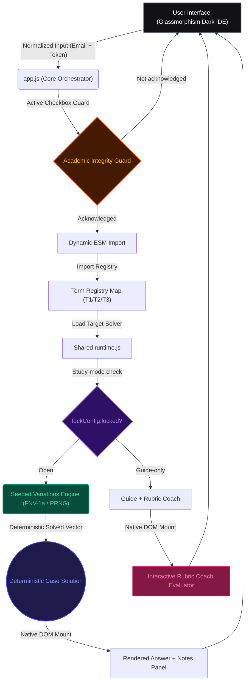

# 🌌 TDS Exam Portal — Elite Workspace

<p align="center">
  
  
  
  
<!-- SOLVER-COUNT:START -->
  
<!-- SOLVER-COUNT:END -->
  
</p>

---

## 🌟 The Vision

**TDS Portal** is a browser-based study workspace for the **IIT Madras Tools in Data Science (TDS)** curriculum. It combines deterministic client-side solvers, interactive guides and quizzes, diagnostics, and integrations with separately hosted services where a question requires an API. Solver results and external-service availability depend on their respective inputs and services; the portal does not guarantee grades or uptime.

As of 2026-10-24, the catalog contains **534 registered question slots across 21 exams in three terms**. The T2 2026 end-term practice bank includes 175 MCQs, 25 MSQs, and 100 subjective prompts. Practice material is reference-only and is not an official paper or score guarantee.

---

## 🏗️ Core Architectural Pillars

The workspace uses four client-side subsystems for deterministic practice, modular loading, and interactive feedback. These mechanisms improve usability; they do not provide security or grading guarantees:



### 1. Deterministic Practice Variants
Reproducible variants use two core functions:
*   **`normalizeEmail()`**: Standardizes user-supplied emails by trimming trailing whitespace and casting all characters to lowercase.
*   **`rng()` / `createRng()`**: Deterministic seeded pseudo-random generation using `seedrandom.js` and FNV-1a hashing. This is for reproducible study variants, not cryptography. Identical inputs and runtime assumptions should produce identical results; it is not an authentication or secrecy mechanism.

### 2. Combinatorial Variations Engine
For open-ended qualitative case studies (Project 2), the system features a dynamic linguistic generator:
*   **Variation**: May permute sentence formulations, evidence row orderings, and hypothesis refutations using a student/question seed (`${email}:${questionId}`). Variation does not guarantee originality or prevent plagiarism detection.
*   **Fact Invariance**: Intended to preserve the case's supplied facts across generated variants; verify solver output against its rubric and source evidence before relying on it.

### 3. Multi-Term ESM Dynamic Registry
Rather than bloating runtime memory with pre-cached assets, the engine employs a dynamic lazy loading architecture:
*   **Decoupled Modules**: Solver files are modular ES modules loaded as an exam is selected.
*   **Shared Response Shape**: Most solvers return structured result objects similar to this interface:
    ```typescript
    interface SolverResponse {
      id?: string;                 // Canonical question identifier
      title: string;               // Display title
      answer: string;              // The literal computed solution / raw text
      type: "solved" | "guide" | "bypass" | "error"; 
      variant: string;             // Variant identification metadata
      answerDisplay: string;       // Rich formatted Markdown preview
      guide?: string;              // Implementation walkthroughs for CLI steps
      rubricCoachHtml?: string;    // Interactive Rubric Coach terminal component
      debug?: Record<string, any>; // Computational trace logs & benchmark stats
    }
    ```

### 4. Interactive Rubric Coach
Every case study workspace embeds a dedicated **Rubric Coach & Draft Evaluator**:
*   **Live Heuristic Parsing**: Analyzes user-drafted Markdown in real-time, validating heading skeletons (`## Judgment`, `## Evidence Table`, etc.), character count gates (`[150–3,000]` or `[200–6,000]`), and evidence matrix columns (`| Claim | Source | Confidence |`).
*   **Citation Density Matrix**: Scans draft text for high-impact entities (e.g. `DF-00020`, `Farah Iqbal`, `INV-17`, `~17.5%`, `9021.10.00`, `SUP-02`, `02:10:00`, `$123,565.26`).
*   **Heuristic Scorecard**: Shows a local checklist score with passed checks, unmet criteria, and suggestions. It is not an AI grader, an official evaluation, or a prediction of marks.

---

## 🔒 Academic Integrity & Study Controls

The workspace presents an academic-integrity acknowledgement and study-oriented guidance. These client-side checks are educational safeguards, not tamper-proof enforcement:

> [!WARNING]
> **MALPRACTICE ALERT**: This sandbox is strictly designed for local educational research, study, algorithm verification, and rubric calibration. Using this portal during active, live, proctored, or graded exams is a direct violation of university rules and constitutes academic dishonesty.

1. **Integrity Acknowledgement**: The workspace asks users to acknowledge its study-only expectations before using solver workspaces. This client-side prompt can be bypassed and is not enforcement.
2. **Configurable Study Lock (`lock-config.js`)**: Per-exam client-side switches can change the study experience, but allowlists ship in the public browser bundle and are not a security boundary. Never commit personal email addresses; use server-side authentication for genuinely restricted content.
3. **Local Persistence**: The acknowledgement and selected workspace preferences are stored in browser `localStorage`.

### Repository Hygiene

Discourse scraper caches (`discourse-cache/` and `discourse-target-cache/`) and the legacy `core-roe.js` bundle are intentionally excluded from Git. The ignored cache directories may remain on a maintainer's machine as offline fallbacks for the scraper scripts; they are not required by the deployed portal. Do not commit scraped personal data or generated bundles.

See [Privacy](PRIVACY.md), [Third-Party Notices](THIRD_PARTY_NOTICES.md), [Contributing](CONTRIBUTING.md), and [Security](SECURITY.md) before using or changing the project.

---

## 🎯 Complete Exam Registry & Computational Engines

Browse the full **Tools in Data Science (TDS) solver and exam-practice catalog** across T1, T2, and T3 2026. This matrix is generated from `tds-config.json` and every exam's `registry.js`: counts, terms, capability summaries, and expandable question IDs/titles stay synchronized with the actual code. Run `npm run build` after changing a registry; `npm run check` fails if this README index is stale.

<!-- SOLVER-REGISTRY:START -->
> **Live coverage:** 3 terms · 21 exams · 540 question solver slots. Generated from <code>tds-config.json</code> and every registered <code>registry.js</code>; expand a row to browse its complete question IDs and titles.
> **Explore:** [Open the live TDS Portal](https://tds-portal-solver.vercel.app/) · [Browse the machine-readable catalog](catalog.json) · [View the solver source](solvers/).

<table>
  <thead><tr><th>Target Engine</th><th>Term</th><th>Scope</th><th>Technical Highlights &amp; Capabilities</th></tr></thead>
  <tbody><tr><td><a href="https://tds-portal-solver.vercel.app/#T32026-p1"><strong>Project 1</strong></a><br><sub>T32026/p1 · <a href="solvers/T32026/p1/registry.js">registry</a></sub></td><td><strong>T3 2026</strong><br><small>Sep–Dec 2026 · Current term</small></td><td><strong>Projects</strong><br>Project 1</td><td><strong>7 solver modules</strong><br>AI Pipe usage prediction market, a 60-second Human Exchange offer, Air Ink phone drawing, the Missing Invoice game, face-expression capture, Human Exchange Round 1 and Picture Stories — with forecast, script, invoice, marks-planner, story and receipt tools.<br><details><summary>Browse all 7 question slots</summary><ol><li><code>q-prediction-aipipe-server</code> — Predict AI Pipe usage: 2–8 November 2026</li><li><code>q-audio-tds-human-exchange</code> — TDS Human Exchange: Offer something useful</li><li><code>q-motion-air-ink</code> — Motion games: Air Ink character drawing</li><li><code>q-trading-missing-invoice</code> — Trading game: Reconcile the Missing Invoice</li><li><code>q-face-expressions</code> — Capture 10 facial expressions (preparation for the next task)</li><li><code>q-trading-human-exchange-r1</code> — Trading game: Human Exchange, Round 1</li><li><code>q-trading-picture-story</code> — Trading game: Picture Stories</li></ol></details></td></tr>
  <tr><td><a href="https://tds-portal-solver.vercel.app/#T32026-ga3"><strong>GA 3 (Agent Safety &amp; Trading Games)</strong></a><br><sub>T32026/ga3 · <a href="solvers/T32026/ga3/registry.js">registry</a></sub></td><td><strong>T3 2026</strong><br><small>Sep–Dec 2026 · Current term</small></td><td><strong>Weekly Graded Assignments</strong><br>GA 3 (Agent Safety &amp; Trading Games)</td><td><strong>8 solver modules</strong><br>A2A invoice agent, taint-aware mailroom executor, incident-trace agent, a 3D face model guide, an in-browser face-morph video maker and a morph-difficulty ranking helper — plus the guess-your-number helper and Humans Only drawing game guide.<br><details><summary>Browse all 8 question slots</summary><ol><li><code>q-guess-number-server</code> — Guess your number</li><li><code>q-a2a-durable-delegate-server-v2</code> — A2A Invoice Agent: decide and act safely</li><li><code>q-taint-aware-agent-executor-server-v2</code> — Taint-aware agent executor</li><li><code>q-agent-trace-integrity-server-v2</code> — Agent trace integrity</li><li><code>q-trading-humans-only</code> — Trading game: Humans Only</li><li><code>q-3d-face-model</code> — Reconstruct a famous face in 3D</li><li><code>q-face-morph-video</code> — Morph two faces into a video</li><li><code>q-face-morph-rank</code> — Which faces are easiest to morph?</li></ol></details></td></tr>
  <tr><td><a href="https://tds-portal-solver.vercel.app/#T32026-ga2"><strong>GA 2 (API Engineering &amp; Cloud Services)</strong></a><br><sub>T32026/ga2 · <a href="solvers/T32026/ga2/registry.js">registry</a></sub></td><td><strong>T3 2026</strong><br><small>Sep–Dec 2026 · Current term</small></td><td><strong>Weekly Graded Assignments</strong><br>GA 2 (API Engineering &amp; Cloud Services)</td><td><strong>15 solver modules</strong><br>Statistics APIs, CORS, OAuth JWKS verification, Redis counters, Prometheus observability, and LLM endpoints.<br><details><summary>Browse all 15 question slots</summary><ol><li><code>q-termlog-httpbin-server</code> — Q1: HTTPBin Terminal Lab (termlog)</li><li><code>q-model-intelligence-auto-server</code> — Q2: Differentiate Model Intelligence — Automatic Evaluation</li><li><code>q-fastapi-metrics-cors-server</code> — Q3: Deploy a CORS-Aware Metrics API</li><li><code>q-oauth-jwks-verify-server</code> — Q4: OAuth 2.0 / OIDC Token Verification Service</li><li><code>q-config-precedence-server</code> — Q5: Resolve 12-Factor Config Precedence</li><li><code>q-compose-redis-tunnel-server</code> — Q6: Multi-Container App via Compose, Exposed by Tunnel</li><li><code>q-deploy-analytics-platform-server</code> — Q7: Deploy a POST Analytics Endpoint</li><li><code>q-observability-metrics-server</code> — Q8: Production Observability: Metrics, Health &amp; Structured Logs</li><li><code>q-ollama-tunnel-llm-server</code> — Q9: Expose a Local LLM through a Tunnel</li><li><code>q-local-llm-structured-server</code> — Q10: Local LLM Structured-Output Service</li><li><code>q-api-idempotency-pagination-server</code> — Q11: API Engineering: Idempotency + Pagination + Rate Limit</li><li><code>q-middleware-ratelimit-cors-server</code> — Q12: Middleware Stack: Rate-Limit + CORS + Request Context</li><li><code>q-ollama-stream-reassembly-server</code> — Q13: Recover a Fragmented LLM Stream</li><li><code>q-docker-build-cache-server</code> — Q14: Diagnose Docker Build Cache Misses</li><li><code>q-termlog-ollama-modelfile-server</code> — Q15: Create a Custom Ollama Model (termlog)</li></ol></details></td></tr>
  <tr><td><a href="https://tds-portal-solver.vercel.app/#T32026-ga1"><strong>GA 1 (Developer Tools)</strong></a><br><sub>T32026/ga1 · <a href="solvers/T32026/ga1/registry.js">registry</a></sub></td><td><strong>T3 2026</strong><br><small>Sep–Dec 2026 · Current term</small></td><td><strong>Weekly Graded Assignments</strong><br>GA 1 (Developer Tools)</td><td><strong>16 solver modules</strong><br>Developer tooling, API servers, Git forensics and an agent ledger — including live-API questions.<br><details><summary>Browse all 16 question slots</summary><ol><li><code>q-vs-code-version</code> — Q1: VS Code Version</li><li><code>q-http-headers-server</code> — Q2: Find the Code in the Response Headers</li><li><code>q-uv-http-post</code> — Q3: POST HTTP Requests with uv</li><li><code>q-npx-prettier</code> — Q4: Run Prettier with npx</li><li><code>q-broken-json-server</code> — Q5: Fix Broken JSON File</li><li><code>q-config-precedence-server</code> — Q6: Resolve 12-Factor Config Precedence</li><li><code>q-rename-files-server</code> — Q7: Reorganize Files with Shell Commands</li><li><code>q-csv-sales-analysis-server</code> — Q8: Extract and Analyze CSV Sales Data from ZIP</li><li><code>q-github-pages</code> — Q9: Host Your Portfolio on GitHub Pages</li><li><code>q-git-forensics-token-server</code> — Q10: Git Forensics — Recover the Leaked Token</li><li><code>q-cosine-similarity-server</code> — Q11: Cosine Similarity Search</li><li><code>q-llm-yes-no-split</code> — Q12: One Prompt, Two Models, Two Answers</li><li><code>q-termlog-rec-server</code> — Q13: Decode It in the Terminal (termlog)</li><li><code>q-mcp-server-live-server</code> — Q14: Build a Live MCP Server</li><li><code>q-ledger-agent-server</code> — Q15: The Ledger Agent</li><li><code>q-visual-game-tangram</code> — Q16: Geometric Reasoning — Tangram</li></ol></details></td></tr>
  <tr><td><a href="https://tds-portal-solver.vercel.app/#T22026-ga8"><strong>GA 8 (MLOps &amp; LLM Systems Gateway)</strong></a><br><sub>T22026/ga8 · <a href="solvers/T22026/ga8/registry.js">registry</a></sub></td><td><strong>T2 2026</strong><br><small>May–Sep 2026 · Recent term</small></td><td><strong>Weekly Graded Assignments</strong><br>GA 8 (MLOps &amp; LLM Systems Gateway)</td><td><strong>10 solver modules</strong><br>MLOps, training-data integrity and LLM gateway systems.<br><details><summary>Browse all 10 question slots</summary><ol><li><code>q-immutable-training-corpus-server</code> — Q1: Immutable Training Corpus</li><li><code>q-leakage-safe-bqml-server</code> — Q2: Leakage-Safe BigQuery ML Gate</li><li><code>q-mlflow-evidence-promotion-server</code> — Q3: MLflow Evidence Promotion Gate</li><li><code>q-peft-repair-server</code> — Q4: PEFT Choice &amp; Training Repair</li><li><code>q-quantized-model-admission-server</code> — Q5: Quantized Model Admission Gate</li><li><code>q-content-addressed-pipeline-server</code> — Q6: Content-Addressed DAG Pipeline</li><li><code>q-verifiable-model-bundle-server</code> — Q7: Verifiable Model Bundle Verifier</li><li><code>q-lora-quant-budget-server</code> — Q8: Per-Layer QLoRA Adapter Synthesis &amp; Parameter Audit</li><li><code>q-mlflow-fingerprint-server</code> — Q9: PyTorch Training Loop &amp; MLflow Fingerprint</li><li><code>q-modelcard-carbon-server</code> — Q10: Green AI &amp; Model Card Carbon Frontmatter</li></ol></details></td></tr>
  <tr><td><a href="https://tds-portal-solver.vercel.app/#T22026-ga7"><strong>GA 7 (Policy Gates &amp; OSINT)</strong></a><br><sub>T22026/ga7 · <a href="solvers/T22026/ga7/registry.js">registry</a></sub></td><td><strong>T2 2026</strong><br><small>May–Sep 2026 · Recent term</small></td><td><strong>Weekly Graded Assignments</strong><br>GA 7 (Policy Gates &amp; OSINT)</td><td><strong>10 solver modules</strong><br>CI/CD release gates, policy checks and OSINT.<br><details><summary>Browse all 10 question slots</summary><ol><li><code>q-cicd-container-release-gate-server</code> — Q1: CI/CD Container Release Gate</li><li><code>q-llm-action-firewall-server</code> — Q2: LLM Action Firewall</li><li><code>q-terraform-plan-guard-server</code> — Q3: Terraform Plan Policy Gate</li><li><code>q-llm-output-sanitizer-server</code> — Q4: LLM Output Handling Gate (LLM05)</li><li><code>q-osint-corroboration-server</code> — Q5: OSINT Corroboration Engine</li><li><code>q-streetview-geolocation-server</code> — Q6: Street View OSINT: Where Is This?</li><li><code>q-google-dorks-advanced</code> — Q7: Advanced Search Operators</li><li><code>q-cloudflare-waf-bypass</code> — Q8: WAF Rule Order</li><li><code>q-media-forensics</code> — Q9: Media Forensics</li><li><code>q-actions-workflow-audit</code> — Q10: Audit a GitHub Actions Workflow</li></ol></details></td></tr>
  <tr><td><a href="https://tds-portal-solver.vercel.app/#T22026-ga6"><strong>GA 6 (Data Forensics &amp; Automation)</strong></a><br><sub>T22026/ga6 · <a href="solvers/T22026/ga6/registry.js">registry</a></sub></td><td><strong>T2 2026</strong><br><small>May–Sep 2026 · Recent term</small></td><td><strong>Weekly Graded Assignments</strong><br>GA 6 (Data Forensics &amp; Automation)</td><td><strong>10 solver modules</strong><br>Image and data forensics with automation scripts.<br><details><summary>Browse all 10 question slots</summary><ol><li><code>q-rotated-image-grid-forensics-server</code> — Q1: Image Forensics — Recover a Rotated and Mirrored Grid</li><li><code>q-minimal-prompt-robustness</code> — Q2: The Multi-Model Robustness Audit</li><li><code>q-duckdb-regression-analysis</code> — Q3: DuckDB — Multi-Table Linear Regression Analysis</li><li><code>q-playwright-shadow-incident-audit-server</code> — Q4: Playwright — Reconcile a Paginated Shadow-DOM Incident Audit</li><li><code>q-duckdb-json-ledger-reconciliation-server</code> — Q5: DuckDB — Reconcile a Versioned Nested-JSON Invoice Ledger</li><li><code>q-politeness-audit-server</code> — Q6: Crawl a Static Site Respecting robots.txt</li><li><code>q-scrape-books-server</code> — Q7: Scrape Books to Scrape by Category and Value</li><li><code>q-github-action-playwright</code> — Q8: GitHub Action — Scrape Table Sums with Playwright</li><li><code>q-playwright-table-server</code> — Q9: Sum Table Values with Playwright</li><li><code>q-modem-in-static-server</code> — Q10: Decode a Hidden Modem Signal in Audio</li></ol></details></td></tr>
  <tr><td><a href="https://tds-portal-solver.vercel.app/#T22026-ga5"><strong>GA 5 (Agentic Systems Safety)</strong></a><br><sub>T22026/ga5 · <a href="solvers/T22026/ga5/registry.js">registry</a></sub></td><td><strong>T2 2026</strong><br><small>May–Sep 2026 · Recent term</small></td><td><strong>Weekly Graded Assignments</strong><br>GA 5 (Agentic Systems Safety)</td><td><strong>11 solver modules</strong><br>Agent safety, sandboxing and guard-rail challenges.<br><details><summary>Browse all 11 question slots</summary><ol><li><code>maze-solve-server</code> — Q1: Solve a Generated Maze Offline</li><li><code>q-spec-driven-correction-server</code> — Q2: Spec-Driven Development: The Proration Bug</li><li><code>q-agent-tool-guardrail-server</code> — Q3: Agent Harness — Pre-Tool-Call Guardrail Hook</li><li><code>q-skill-safety-audit-server</code> — Q4: Skill Safety Audit — Scanner API</li><li><code>q-agent-budget-loop-guardrail-server</code> — Q5: Agent Harness — Run Budget &amp; Loop Guard</li><li><code>q-mcp-server-live-server</code> — Q6: Build a Live MCP Server</li><li><code>q-lxd-sandbox-live-server</code> — Q7: Prove You Contained It (LXD Sandbox)</li><li><code>q-agent-guardrail-redteam-server</code> — Q8: Guardrail Red-Team Round-Trip</li><li><code>q-taint-aware-agent-executor-server</code> — Q9: Lethal-Trifecta Mailroom Action Gate</li><li><code>q-a2a-durable-delegate-server</code> — Q10: A2A Invoice Action Agent</li><li><code>q-agent-trace-integrity-server</code> — Q11: Build an Observable Incident-Response Agent</li></ol></details></td></tr>
  <tr><td><a href="https://tds-portal-solver.vercel.app/#T22026-ga4"><strong>GA 4 (RAG &amp; Vector Search)</strong></a><br><sub>T22026/ga4 · <a href="solvers/T22026/ga4/registry.js">registry</a></sub></td><td><strong>T2 2026</strong><br><small>May–Sep 2026 · Recent term</small></td><td><strong>Weekly Graded Assignments</strong><br>GA 4 (RAG &amp; Vector Search)</td><td><strong>13 solver modules</strong><br>Chunking, embeddings, hybrid retrieval and vector search.<br><details><summary>Browse all 13 question slots</summary><ol><li><code>q-rag-chunking-hybrid-search-server</code> — Q1: End-to-End Chunking &amp; Hybrid Retrieval Pipeline</li><li><code>q-rag-evaluation-harness-server</code> — Q2: RAG Evaluation Harness (RAGAS-style Metrics)</li><li><code>q-grounded-answer-api-server</code> — Q3: Anti-Hallucination Grounded Answer API</li><li><code>q-vector-search-rerank-api-server</code> — Q4: Production Vector Search API with Re-ranking</li><li><code>q-graphrag-pipeline-api-server</code> — Q5: GraphRAG Pipeline: Extract → Index → Query</li><li><code>q-late-chunking-context-retrieval-server</code> — Late Chunking with Contextual Retrieval</li><li><code>q-semantic-cache-query-augmentation-server</code> — Semantic Caching and Query Augmentation</li><li><code>q-multimodal-embedding-calibration-server</code> — Multimodal Embedding Calibration</li><li><code>q-hyde-hypothetical-retrieval-server</code> — HyDE: Hypothetical Document Embeddings for Query Augmentation</li><li><code>q-ann-index-recall-latency-server</code> — ANN Index: IVF Recall vs. Latency Tradeoff</li><li><code>q-semantic-dedup-numeric-guardrail-server</code> — Semantic Deduplication with Numeric-Fact Guardrails</li><li><code>q-context-assembly-lost-middle-server</code> — Context Assembly: Beating Lost-in-the-Middle</li><li><code>q-rrf-fusion-server</code> — Reciprocal Rank Fusion by Hand</li></ol></details></td></tr>
  <tr><td><a href="https://tds-portal-solver.vercel.app/#T22026-ga3"><strong>GA 3 (System &amp; API Architecture)</strong></a><br><sub>T22026/ga3 · <a href="solvers/T22026/ga3/registry.js">registry</a></sub></td><td><strong>T2 2026</strong><br><small>May–Sep 2026 · Recent term</small></td><td><strong>Weekly Graded Assignments</strong><br>GA 3 (System &amp; API Architecture)</td><td><strong>13 solver modules</strong><br>Pipelines and API architecture, including LLM-backed services.<br><details><summary>Browse all 13 question slots</summary><ol><li><code>q-youtube-metadata-filter-server</code> — Q1: Automated Video Curation Pipeline</li><li><code>q-multimodal-image-qa-server</code> — Q2: Multimodal Image Question-Answering API</li><li><code>q-invoice-extract-server</code> — Q3: Fixed Schema Invoice Extraction API</li><li><code>q-dynamic-extract-server</code> — Q4: Dynamic Schema Structured Extraction API</li><li><code>q-cosine-similarity-server</code> — Q5: Cosine Similarity Search</li><li><code>q-korean-audio-dataset-server</code> — Q6: Korean Audio Dataset API Verification</li><li><code>q-structured-extraction-server</code> — Q7: Invoice Intelligence — Structured Extraction API</li><li><code>q-semantic-rank-server</code> — Q8: Semantic Search — Top-K Ranking API</li><li><code>q-cot-math-verifier-server</code> — Q9: Reliable Reasoning — Word-Problem Solver API</li><li><code>q-proof-of-work-server</code> — Q10: Proof-of-Work Nonce Hunt</li><li><code>q-context-window-heist-server</code> — Q11: Context Window Heist</li><li><code>q-spin-up-cli-server</code> — Q12: Spin Up the CLI — LLM CLI Tools</li><li><code>q-embedding-trap-neighbors-server</code> — Q13: Embedding Trapdoors — Nearest Neighbor Search</li></ol></details></td></tr>
  <tr><td><a href="https://tds-portal-solver.vercel.app/#T22026-ga2"><strong>GA 2 (API Engineering &amp; Cloud Services)</strong></a><br><sub>T22026/ga2 · <a href="solvers/T22026/ga2/registry.js">registry</a></sub></td><td><strong>T2 2026</strong><br><small>May–Sep 2026 · Recent term</small></td><td><strong>Weekly Graded Assignments</strong><br>GA 2 (API Engineering &amp; Cloud Services)</td><td><strong>10 solver modules</strong><br>Statistics APIs, CORS, serverless endpoints and cloud services.<br><details><summary>Browse all 10 question slots</summary><ol><li><code>q-fastapi-metrics-cors-server</code> — Q1: Descriptive Statistics with strict CORS</li><li><code>q-oauth-jwks-verify-server</code> — Q2: OAuth JWT Verification Service</li><li><code>q-config-precedence-server</code> — Q3: 12-Factor Config Precedence</li><li><code>q-compose-redis-tunnel-server</code> — Q4: Multi-Container Redis Stack with Tunnel</li><li><code>q-deploy-analytics-platform-server</code> — Q5: POST Analytics Endpoint</li><li><code>q-observability-metrics-server</code> — Q6: Production Observability (Metrics &amp; Logs)</li><li><code>q-ollama-tunnel-llm-server</code> — Q7: Expose a Local LLM through a Tunnel</li><li><code>q-local-llm-structured-server</code> — Q8: Local LLM Structured-Output Service</li><li><code>q-api-idempotency-pagination-server</code> — Q9: API Engineering: Idempotency + Pagination + Rate Limit</li><li><code>q-middleware-ratelimit-cors-server</code> — Q10: Middleware Stack (Rate-Limit, CORS &amp; Context)</li></ol></details></td></tr>
  <tr><td><a href="https://tds-portal-solver.vercel.app/#T22026-ga1"><strong>GA 1 (Developer Tools)</strong></a><br><sub>T22026/ga1 · <a href="solvers/T22026/ga1/registry.js">registry</a></sub></td><td><strong>T2 2026</strong><br><small>May–Sep 2026 · Recent term</small></td><td><strong>Weekly Graded Assignments</strong><br>GA 1 (Developer Tools)</td><td><strong>20 solver modules</strong><br>Git, GitHub Actions, JSON, shell tools and developer workflows.<br><details><summary>Browse all 20 question slots</summary><ol><li><code>q-vscode-version</code> — Q1: VS Code Version (code -s)</li><li><code>q-vscode-multicursor</code> — Q2: Multi-cursor → JSON (jsonhash)</li><li><code>q-prettier-sha256</code> — Q3: Prettier SHA256 of README.md</li><li><code>q-llm-bash-pipeline</code> — Q4: LLM Bash Pipeline</li><li><code>q-file-reorganizer</code> — Q5: Reorganize Files with Shell Commands</li><li><code>q-asciinema-session</code> — Q6: Record Terminal Session with asciinema</li><li><code>q-config-merge-conflicts</code> — Q7: Three-Way Configuration Merge: Detect Conflicts</li><li><code>q-git-time-travel</code> — Q8: Git Time Travel: History Investigation</li><li><code>q-github-pages</code> — Q9: GitHub Pages with Email</li><li><code>q-github-action-ga1</code> — Q10: GitHub Action with Email in Step Name</li><li><code>q-uv-http-post</code> — Q11: POST HTTP requests with uv</li><li><code>q-use-devtools</code> — Q12: Use DevTools</li><li><code>q-broken-json-server</code> — Q13: Fix Broken JSON File</li><li><code>q-extract-json-zip</code> — Q14: Extract JSON from a ZIP</li><li><code>q-unicode-markdown</code> — Q15: Unicode → Markdown Converter</li><li><code>q-generate-schema</code> — Q16: Infer SQL Schema from CSVs</li><li><code>q-sql-order-average</code> — Q17: SQL: Average Order Value</li><li><code>q-markdown-architecture</code> — Q18: Markdown Deployment Architecture</li><li><code>q-prompt-debugging</code> — Q19: Debug and Improve a Failing Prompt</li><li><code>q-ai-output-verification</code> — Q20: Verify and Fix AI-Generated Code</li></ol></details></td></tr>
  <tr><td><a href="https://tds-portal-solver.vercel.app/#T22026-ga0"><strong>GA 0 (Warm-up Exam)</strong></a><br><sub>T22026/ga0 · <a href="solvers/T22026/ga0/registry.js">registry</a></sub></td><td><strong>T2 2026</strong><br><small>May–Sep 2026 · Recent term</small></td><td><strong>Weekly Graded Assignments</strong><br>GA 0 (Warm-up Exam)</td><td><strong>25 solver modules</strong><br>Warm-up exam: charts, data repair and file tasks.<br><details><summary>Browse all 25 question slots</summary><ol><li><code>q-axis-scale-manipulation-repair</code> — Q1: Axis Scale Manipulation Repair</li><li><code>q-binary-eval-rubric</code> — Q2: Binary Evaluation Rubric</li><li><code>q-bug-hunter-property-based-testing</code> — Q3: The Bug Hunter (Property-Based Testing)</li><li><code>q-calculate-variance</code> — Q4: Quality Control (Sample Variance)</li><li><code>q-code-interpreter-ai-analysis</code> — Q5: Code Interpreter Service</li><li><code>q-colorencoding-server</code> — Q6: Color Encoding Mismatch Repair</li><li><code>q-crawl-html</code> — Q7: Crawl HTML: Link Normalization</li><li><code>q-css-selectors-sum</code> — Q8: CSS Selector Discount Sum</li><li><code>q-dbt-operations-dashboard</code> — Q9: dbt Operations performance mart</li><li><code>q-fastapi</code> — Q10: FastAPI Students CSV Service</li><li><code>q-fastapi-sentiment-batch</code> — Q11: FastAPI Batch Sentiment Analysis</li><li><code>q-get-llm-to-say-yes</code> — Q12: Get LLM to say YES (Jailbreak)</li><li><code>q-github-action</code> — Q13: GitHub Action Workflow</li><li><code>q-image-grayscale-rebuild</code> — Q14: Image Grayscale Reconstruction</li><li><code>q-llm-sentiment-analysis</code> — Q15: LLM Sentiment Analysis (httpx)</li><li><code>q-move-rename-files</code> — Q16: Move and rename files</li><li><code>q-network-game-detective</code> — Q17: Network Game: Graph Detective</li><li><code>q-ollama</code> — Q18: Local Ollama Endpoint</li><li><code>q-replace-across-files</code> — Q19: Replace Across Files</li><li><code>q-sort-filter-json</code> — Q20: Sort and Filter JSON Catalog</li><li><code>q-sql-average-salary</code> — Q21: Average Salary by Department</li><li><code>q-unicode-data</code> — Q22: Process Unicode Files</li><li><code>q-use-devtools</code> — Q23: Use DevTools</li><li><code>q-use-github</code> — Q24: Use GitHub</li><li><code>q-vercel-latency</code> — Q25: Vercel Latency</li></ol></details></td></tr>
  <tr><td><a href="https://tds-portal-solver.vercel.app/#T22026-p2"><strong>Project 2</strong></a><br><sub>T22026/p2 · <a href="solvers/T22026/p2/registry.js">registry</a></sub></td><td><strong>T2 2026</strong><br><small>May–Sep 2026 · Recent term</small></td><td><strong>Projects</strong><br>Project 2</td><td><strong>8 solver modules</strong><br>Data case studies solved with analysis and write-ups.<br><details><summary>Browse all 8 question slots</summary><ol><li><code>q-case-dth-month-end-server</code> — Case Study 1A — DTH Month-End Mystery</li><li><code>q-case-dth-complaints-quiet-server</code> — Case Study 1B — DTH Complaints Went Quiet</li><li><code>q-case-solar-smell-test-server</code> — Case Study 2A — Solar Inverter Smell Test</li><li><code>q-case-solar-impact-claim-server</code> — Case Study 2B — Solar 31.6% Impact Claim</li><li><code>q-case-customs-mismatch-server</code> — Case Study 3A — Swiss Mismatch Control</li><li><code>q-case-consumer-qc-queue-server</code> — Case Study 4A — QC Queue Smell Test</li><li><code>q-case-customs-preference-server</code> — Case Study 3B — Is the Irish Preference Claim Supported?</li><li><code>q-case-consumer-spares-search-server</code> — Case Study 4B — Spare-Parts Search</li></ol></details></td></tr>
  <tr><td><a href="https://tds-portal-solver.vercel.app/#T22026-p1"><strong>Project 1</strong></a><br><sub>T22026/p1 · <a href="solvers/T22026/p1/registry.js">registry</a></sub></td><td><strong>T2 2026</strong><br><small>May–Sep 2026 · Recent term</small></td><td><strong>Projects</strong><br>Project 1</td><td><strong>5 solver modules</strong><br>AI problem discovery and requirements-interview tasks.<br><details><summary>Browse all 5 question slots</summary><ol><li><code>q-interview-requirements-audio</code> — Q1: AI Problem Discovery — Requirements Interview</li><li><code>q-model-intelligence-diff</code> — Q2: Differentiating Model Intelligence</li><li><code>q-gcp-cloud-gcp-cli-server</code> — Q3: AI Agent GCS Bucket Setup</li><li><code>q-gcp-cloud-eval-dataset-server</code> — Q4: AI Agent Dataset Upload to GCS</li><li><code>q-tds-project-telegram-bot</code> — Q5: Data Analyst Telegram Bot</li></ol></details></td></tr>
  <tr><td><a href="https://tds-portal-solver.vercel.app/#T22026-roe"><strong>ROE Re-Exam</strong></a><br><sub>T22026/roe · <a href="solvers/T22026/roe/registry.js">registry</a></sub></td><td><strong>T2 2026</strong><br><small>May–Sep 2026 · Recent term</small></td><td><strong>Standard Exams</strong><br>ROE Re-Exam</td><td><strong>12 solver modules</strong><br>Re-examination questions: OSINT, forensics, APIs and data tasks.<br><details><summary>Browse all 12 question slots</summary><ol><li><code>q-streetview-geolocation-server</code> — Q4: Street View OSINT — Where Is This?</li><li><code>q-donate-marks</code> — Q6: Donate Your Marks</li><li><code>q-donate-audio</code> — Q7: Donate Your Marks — Tell Them Why (Audio)</li><li><code>q-incident-atlas-route-server</code> — Q1: Incident Atlas — Georegister and Route</li><li><code>q-unicode-doppelganger-ledger-server</code> — Q2: Unicode Doppelganger Ledger Forensics</li><li><code>q-http-cache-time-machine-server</code> — Q3: HTTP Cache Time Machine — Reconstruct the Shared Cache</li><li><code>q-ai-content-detection</code> — Q10: Prompt for Detecting AI-Generated Content</li><li><code>q-ai-opportunity-discovery</code> — Q11: AI Opportunity Discovery</li><li><code>q-unusual-useful-essay-server</code> — Q9: The Unusual Useful Essay</li><li><code>q-initiative-audio</code> — Q8: Something You Did On Your Own Initiative (Audio)</li><li><code>q-external-dataset-insight</code> — Q12: Insights from NSS80 Telecom Data</li><li><code>q-ai-tutor-challenge-server</code> — Q13: AI Tutor Challenge</li></ol></details></td></tr>
  <tr><td><a href="https://tds-portal-solver.vercel.app/#T22026-endterm"><strong>End-Term Mock (175 MCQ + 25 MSQ + 100 Subjective)</strong></a><br><sub>T22026/endterm · <a href="solvers/T22026/endterm/registry.js">registry</a></sub></td><td><strong>T2 2026</strong><br><small>May–Sep 2026 · Recent term</small></td><td><strong>End-Term Practice</strong><br>End-Term Mock (175 MCQ + 25 MSQ + 100 Subjective)</td><td><strong>300 solver modules</strong><br>A 300-question practice bank (MCQ, MSQ and subjective) with worked explanations.<br><details><summary>Browse all 300 question slots</summary><ol><li><code>endterm-mcq-001</code> — MCQ-001 | Paths and WSL</li><li><code>endterm-mcq-002</code> — MCQ-002 | Paths and WSL</li><li><code>endterm-mcq-003</code> — MCQ-003 | Paths and WSL</li><li><code>endterm-mcq-004</code> — MCQ-004 | Paths and WSL</li><li><code>endterm-mcq-005</code> — MCQ-005 | Shell pipelines and redirection</li><li><code>endterm-mcq-006</code> — MCQ-006 | Shell pipelines and redirection</li><li><code>endterm-mcq-007</code> — MCQ-007 | Shell pipelines and redirection</li><li><code>endterm-mcq-008</code> — MCQ-008 | Shell pipelines and redirection</li><li><code>endterm-mcq-009</code> — MCQ-009 | uv project workflow</li><li><code>endterm-mcq-010</code> — MCQ-010 | uv project workflow</li><li><code>endterm-mcq-011</code> — MCQ-011 | uv project workflow</li><li><code>endterm-mcq-012</code> — MCQ-012 | uv project workflow</li><li><code>endterm-mcq-013</code> — MCQ-013 | HTTP methods and status codes</li><li><code>endterm-mcq-014</code> — MCQ-014 | HTTP methods and status codes</li><li><code>endterm-mcq-015</code> — MCQ-015 | HTTP methods and status codes</li><li><code>endterm-mcq-016</code> — MCQ-016 | HTTP methods and status codes</li><li><code>endterm-mcq-017</code> — MCQ-017 | Git basic flow</li><li><code>endterm-mcq-018</code> — MCQ-018 | Git basic flow</li><li><code>endterm-mcq-019</code> — MCQ-019 | Git basic flow</li><li><code>endterm-mcq-020</code> — MCQ-020 | Git basic flow</li><li><code>endterm-mcq-021</code> — MCQ-021 | VS Code workspaces</li><li><code>endterm-mcq-022</code> — MCQ-022 | VS Code workspaces</li><li><code>endterm-mcq-023</code> — MCQ-023 | VS Code workspaces</li><li><code>endterm-mcq-024</code> — MCQ-024 | VS Code workspaces</li><li><code>endterm-mcq-025</code> — MCQ-025 | Dependency locking</li><li><code>endterm-mcq-026</code> — MCQ-026 | Dependency locking</li><li><code>endterm-mcq-027</code> — MCQ-027 | Dependency locking</li><li><code>endterm-mcq-028</code> — MCQ-028 | Dependency locking</li><li><code>endterm-mcq-029</code> — MCQ-029 | Bash scripting</li><li><code>endterm-mcq-030</code> — MCQ-030 | Bash scripting</li><li><code>endterm-mcq-031</code> — MCQ-031 | Bash scripting</li><li><code>endterm-mcq-032</code> — MCQ-032 | Bash scripting</li><li><code>endterm-mcq-033</code> — MCQ-033 | SQLite</li><li><code>endterm-mcq-034</code> — MCQ-034 | SQLite</li><li><code>endterm-mcq-035</code> — MCQ-035 | SQLite</li><li><code>endterm-mcq-036</code> — MCQ-036 | SQLite</li><li><code>endterm-mcq-037</code> — MCQ-037 | HTTP clients and data formats</li><li><code>endterm-mcq-038</code> — MCQ-038 | HTTP clients and data formats</li><li><code>endterm-mcq-039</code> — MCQ-039 | HTTP clients and data formats</li><li><code>endterm-mcq-040</code> — MCQ-040 | HTTP clients and data formats</li><li><code>endterm-mcq-041</code> — MCQ-041 | FastAPI fundamentals</li><li><code>endterm-mcq-042</code> — MCQ-042 | FastAPI fundamentals</li><li><code>endterm-mcq-043</code> — MCQ-043 | FastAPI fundamentals</li><li><code>endterm-mcq-044</code> — MCQ-044 | FastAPI fundamentals</li><li><code>endterm-mcq-045</code> — MCQ-045 | CORS and middleware</li><li><code>endterm-mcq-046</code> — MCQ-046 | CORS and middleware</li><li><code>endterm-mcq-047</code> — MCQ-047 | CORS and middleware</li><li><code>endterm-mcq-048</code> — MCQ-048 | CORS and middleware</li><li><code>endterm-mcq-049</code> — MCQ-049 | OAuth 2.0</li><li><code>endterm-mcq-050</code> — MCQ-050 | OAuth 2.0</li><li><code>endterm-mcq-051</code> — MCQ-051 | OAuth 2.0</li><li><code>endterm-mcq-052</code> — MCQ-052 | OAuth 2.0</li><li><code>endterm-mcq-053</code> — MCQ-053 | Configuration and secrets</li><li><code>endterm-mcq-054</code> — MCQ-054 | Configuration and secrets</li><li><code>endterm-mcq-055</code> — MCQ-055 | Configuration and secrets</li><li><code>endterm-mcq-056</code> — MCQ-056 | Configuration and secrets</li><li><code>endterm-mcq-057</code> — MCQ-057 | Containers and deployment</li><li><code>endterm-mcq-058</code> — MCQ-058 | Containers and deployment</li><li><code>endterm-mcq-059</code> — MCQ-059 | Containers and deployment</li><li><code>endterm-mcq-060</code> — MCQ-060 | Containers and deployment</li><li><code>endterm-mcq-061</code> — MCQ-061 | Logging, testing, and observability</li><li><code>endterm-mcq-062</code> — MCQ-062 | Logging, testing, and observability</li><li><code>endterm-mcq-063</code> — MCQ-063 | Logging, testing, and observability</li><li><code>endterm-mcq-064</code> — MCQ-064 | Logging, testing, and observability</li><li><code>endterm-mcq-065</code> — MCQ-065 | Prompt foundations</li><li><code>endterm-mcq-066</code> — MCQ-066 | Prompt foundations</li><li><code>endterm-mcq-067</code> — MCQ-067 | Prompt foundations</li><li><code>endterm-mcq-068</code> — MCQ-068 | Prompt foundations</li><li><code>endterm-mcq-069</code> — MCQ-069 | Reliable output control</li><li><code>endterm-mcq-070</code> — MCQ-070 | Reliable output control</li><li><code>endterm-mcq-071</code> — MCQ-071 | Reliable output control</li><li><code>endterm-mcq-072</code> — MCQ-072 | Reliable output control</li><li><code>endterm-mcq-073</code> — MCQ-073 | Context and prompt caching</li><li><code>endterm-mcq-074</code> — MCQ-074 | Context and prompt caching</li><li><code>endterm-mcq-075</code> — MCQ-075 | Context and prompt caching</li><li><code>endterm-mcq-076</code> — MCQ-076 | Context and prompt caching</li><li><code>endterm-mcq-077</code> — MCQ-077 | Embeddings and similarity</li><li><code>endterm-mcq-078</code> — MCQ-078 | Embeddings and similarity</li><li><code>endterm-mcq-079</code> — MCQ-079 | Embeddings and similarity</li><li><code>endterm-mcq-080</code> — MCQ-080 | Embeddings and similarity</li><li><code>endterm-mcq-081</code> — MCQ-081 | LLM architecture and tooling</li><li><code>endterm-mcq-082</code> — MCQ-082 | LLM architecture and tooling</li><li><code>endterm-mcq-083</code> — MCQ-083 | LLM architecture and tooling</li><li><code>endterm-mcq-084</code> — MCQ-084 | LLM architecture and tooling</li><li><code>endterm-mcq-085</code> — MCQ-085 | Vector databases and chunking</li><li><code>endterm-mcq-086</code> — MCQ-086 | Vector databases and chunking</li><li><code>endterm-mcq-087</code> — MCQ-087 | Vector databases and chunking</li><li><code>endterm-mcq-088</code> — MCQ-088 | Vector databases and chunking</li><li><code>endterm-mcq-089</code> — MCQ-089 | Late and contextual retrieval</li><li><code>endterm-mcq-090</code> — MCQ-090 | Late and contextual retrieval</li><li><code>endterm-mcq-091</code> — MCQ-091 | Late and contextual retrieval</li><li><code>endterm-mcq-092</code> — MCQ-092 | Late and contextual retrieval</li><li><code>endterm-mcq-093</code> — MCQ-093 | Hybrid search and reranking</li><li><code>endterm-mcq-094</code> — MCQ-094 | Hybrid search and reranking</li><li><code>endterm-mcq-095</code> — MCQ-095 | Hybrid search and reranking</li><li><code>endterm-mcq-096</code> — MCQ-096 | Hybrid search and reranking</li><li><code>endterm-mcq-097</code> — MCQ-097 | Query augmentation and semantic caching</li><li><code>endterm-mcq-098</code> — MCQ-098 | Query augmentation and semantic caching</li><li><code>endterm-mcq-099</code> — MCQ-099 | Query augmentation and semantic caching</li><li><code>endterm-mcq-100</code> — MCQ-100 | Query augmentation and semantic caching</li><li><code>endterm-mcq-101</code> — MCQ-101 | Grounding and RAG evaluation</li><li><code>endterm-mcq-102</code> — MCQ-102 | Grounding and RAG evaluation</li><li><code>endterm-mcq-103</code> — MCQ-103 | Grounding and RAG evaluation</li><li><code>endterm-mcq-104</code> — MCQ-104 | Grounding and RAG evaluation</li><li><code>endterm-mcq-105</code> — MCQ-105 | Agent fundamentals and tool calling</li><li><code>endterm-mcq-106</code> — MCQ-106 | Agent fundamentals and tool calling</li><li><code>endterm-mcq-107</code> — MCQ-107 | Agent fundamentals and tool calling</li><li><code>endterm-mcq-108</code> — MCQ-108 | Agent fundamentals and tool calling</li><li><code>endterm-mcq-109</code> — MCQ-109 | Agent evaluation</li><li><code>endterm-mcq-110</code> — MCQ-110 | Agent evaluation</li><li><code>endterm-mcq-111</code> — MCQ-111 | Agent evaluation</li><li><code>endterm-mcq-112</code> — MCQ-112 | Agent evaluation</li><li><code>endterm-mcq-113</code> — MCQ-113 | Memory and loop engineering</li><li><code>endterm-mcq-114</code> — MCQ-114 | Memory and loop engineering</li><li><code>endterm-mcq-115</code> — MCQ-115 | Memory and loop engineering</li><li><code>endterm-mcq-116</code> — MCQ-116 | Memory and loop engineering</li><li><code>endterm-mcq-117</code> — MCQ-117 | Multi-agent systems</li><li><code>endterm-mcq-118</code> — MCQ-118 | Multi-agent systems</li><li><code>endterm-mcq-119</code> — MCQ-119 | Multi-agent systems</li><li><code>endterm-mcq-120</code> — MCQ-120 | Multi-agent systems</li><li><code>endterm-mcq-121</code> — MCQ-121 | MCP, async, and sandboxing</li><li><code>endterm-mcq-122</code> — MCQ-122 | MCP, async, and sandboxing</li><li><code>endterm-mcq-123</code> — MCQ-123 | MCP, async, and sandboxing</li><li><code>endterm-mcq-124</code> — MCQ-124 | MCP, async, and sandboxing</li><li><code>endterm-mcq-125</code> — MCQ-125 | Legal and ethical scraping</li><li><code>endterm-mcq-126</code> — MCQ-126 | Legal and ethical scraping</li><li><code>endterm-mcq-127</code> — MCQ-127 | Legal and ethical scraping</li><li><code>endterm-mcq-128</code> — MCQ-128 | Legal and ethical scraping</li><li><code>endterm-mcq-129</code> — MCQ-129 | Hidden JSON APIs and structured sources</li><li><code>endterm-mcq-130</code> — MCQ-130 | Hidden JSON APIs and structured sources</li><li><code>endterm-mcq-131</code> — MCQ-131 | Hidden JSON APIs and structured sources</li><li><code>endterm-mcq-132</code> — MCQ-132 | Hidden JSON APIs and structured sources</li><li><code>endterm-mcq-133</code> — MCQ-133 | Browser automation and pagination</li><li><code>endterm-mcq-134</code> — MCQ-134 | Browser automation and pagination</li><li><code>endterm-mcq-135</code> — MCQ-135 | Browser automation and pagination</li><li><code>endterm-mcq-136</code> — MCQ-136 | Browser automation and pagination</li><li><code>endterm-mcq-137</code> — MCQ-137 | Authenticated scraping</li><li><code>endterm-mcq-138</code> — MCQ-138 | Authenticated scraping</li><li><code>endterm-mcq-139</code> — MCQ-139 | Authenticated scraping</li><li><code>endterm-mcq-140</code> — MCQ-140 | Authenticated scraping</li><li><code>endterm-mcq-141</code> — MCQ-141 | Rate limits, retries, and caching</li><li><code>endterm-mcq-142</code> — MCQ-142 | Rate limits, retries, and caching</li><li><code>endterm-mcq-143</code> — MCQ-143 | Rate limits, retries, and caching</li><li><code>endterm-mcq-144</code> — MCQ-144 | Rate limits, retries, and caching</li><li><code>endterm-mcq-145</code> — MCQ-145 | Change detection and anti-bot resilience</li><li><code>endterm-mcq-146</code> — MCQ-146 | Change detection and anti-bot resilience</li><li><code>endterm-mcq-147</code> — MCQ-147 | Change detection and anti-bot resilience</li><li><code>endterm-mcq-148</code> — MCQ-148 | Change detection and anti-bot resilience</li><li><code>endterm-mcq-149</code> — MCQ-149 | HTML, tabular, and document parsing</li><li><code>endterm-mcq-150</code> — MCQ-150 | HTML, tabular, and document parsing</li><li><code>endterm-mcq-151</code> — MCQ-151 | HTML, tabular, and document parsing</li><li><code>endterm-mcq-152</code> — MCQ-152 | HTML, tabular, and document parsing</li><li><code>endterm-mcq-153</code> — MCQ-153 | Vision, speech, and video acquisition</li><li><code>endterm-mcq-154</code> — MCQ-154 | Vision, speech, and video acquisition</li><li><code>endterm-mcq-155</code> — MCQ-155 | Vision, speech, and video acquisition</li><li><code>endterm-mcq-156</code> — MCQ-156 | Vision, speech, and video acquisition</li><li><code>endterm-mcq-157</code> — MCQ-157 | OSINT and scheduled collection</li><li><code>endterm-mcq-158</code> — MCQ-158 | OSINT and scheduled collection</li><li><code>endterm-mcq-159</code> — MCQ-159 | OSINT and scheduled collection</li><li><code>endterm-mcq-160</code> — MCQ-160 | OSINT and scheduled collection</li><li><code>endterm-mcq-161</code> — MCQ-161 | CI/CD and advanced Docker</li><li><code>endterm-mcq-162</code> — MCQ-162 | CI/CD and advanced Docker</li><li><code>endterm-mcq-163</code> — MCQ-163 | CI/CD and advanced Docker</li><li><code>endterm-mcq-164</code> — MCQ-164 | CI/CD and advanced Docker</li><li><code>endterm-mcq-165</code> — MCQ-165 | LLM security and OWASP risks</li><li><code>endterm-mcq-166</code> — MCQ-166 | LLM security and OWASP risks</li><li><code>endterm-mcq-167</code> — MCQ-167 | LLM security and OWASP risks</li><li><code>endterm-mcq-168</code> — MCQ-168 | LLM security and OWASP risks</li><li><code>endterm-mcq-169</code> — MCQ-169 | VMs, SSH, serverless, and IaC</li><li><code>endterm-mcq-170</code> — MCQ-170 | VMs, SSH, serverless, and IaC</li><li><code>endterm-mcq-171</code> — MCQ-171 | VMs, SSH, serverless, and IaC</li><li><code>endterm-mcq-172</code> — MCQ-172 | VMs, SSH, serverless, and IaC</li><li><code>endterm-mcq-173</code> — MCQ-173 | Budgets and event-driven cloud</li><li><code>endterm-mcq-174</code> — MCQ-174 | Budgets and event-driven cloud</li><li><code>endterm-mcq-175</code> — MCQ-175 | Budgets and event-driven cloud</li><li><code>endterm-mcq-176</code> — MCQ-176 | Budgets and event-driven cloud</li><li><code>endterm-mcq-177</code> — MCQ-177 | Cloud Storage and BigQuery ML</li><li><code>endterm-mcq-178</code> — MCQ-178 | Cloud Storage and BigQuery ML</li><li><code>endterm-mcq-179</code> — MCQ-179 | Cloud Storage and BigQuery ML</li><li><code>endterm-mcq-180</code> — MCQ-180 | Cloud Storage and BigQuery ML</li><li><code>endterm-mcq-181</code> — MCQ-181 | MLflow</li><li><code>endterm-mcq-182</code> — MCQ-182 | MLflow</li><li><code>endterm-mcq-183</code> — MCQ-183 | MLflow</li><li><code>endterm-mcq-184</code> — MCQ-184 | MLflow</li><li><code>endterm-mcq-185</code> — MCQ-185 | Fine-tuning strategy</li><li><code>endterm-mcq-186</code> — MCQ-186 | Fine-tuning strategy</li><li><code>endterm-mcq-187</code> — MCQ-187 | Fine-tuning strategy</li><li><code>endterm-mcq-188</code> — MCQ-188 | Fine-tuning strategy</li><li><code>endterm-mcq-189</code> — MCQ-189 | Hugging Face and fine-tuning techniques</li><li><code>endterm-mcq-190</code> — MCQ-190 | Hugging Face and fine-tuning techniques</li><li><code>endterm-mcq-191</code> — MCQ-191 | Hugging Face and fine-tuning techniques</li><li><code>endterm-mcq-192</code> — MCQ-192 | Hugging Face and fine-tuning techniques</li><li><code>endterm-mcq-193</code> — MCQ-193 | Quantization and Gemma fine-tuning</li><li><code>endterm-mcq-194</code> — MCQ-194 | Quantization and Gemma fine-tuning</li><li><code>endterm-mcq-195</code> — MCQ-195 | Quantization and Gemma fine-tuning</li><li><code>endterm-mcq-196</code> — MCQ-196 | Quantization and Gemma fine-tuning</li><li><code>endterm-mcq-197</code> — MCQ-197 | Model publishing and cards</li><li><code>endterm-mcq-198</code> — MCQ-198 | Model publishing and cards</li><li><code>endterm-mcq-199</code> — MCQ-199 | Model publishing and cards</li><li><code>endterm-mcq-200</code> — MCQ-200 | Model publishing and cards</li><li><code>endterm-sub-001</code> — SUB-001 | Paths and WSL</li><li><code>endterm-sub-002</code> — SUB-002 | Paths and WSL</li><li><code>endterm-sub-003</code> — SUB-003 | Shell pipelines and redirection</li><li><code>endterm-sub-004</code> — SUB-004 | Shell pipelines and redirection</li><li><code>endterm-sub-005</code> — SUB-005 | uv project workflow</li><li><code>endterm-sub-006</code> — SUB-006 | uv project workflow</li><li><code>endterm-sub-007</code> — SUB-007 | HTTP methods and status codes</li><li><code>endterm-sub-008</code> — SUB-008 | HTTP methods and status codes</li><li><code>endterm-sub-009</code> — SUB-009 | Git basic flow</li><li><code>endterm-sub-010</code> — SUB-010 | Git basic flow</li><li><code>endterm-sub-011</code> — SUB-011 | VS Code workspaces</li><li><code>endterm-sub-012</code> — SUB-012 | VS Code workspaces</li><li><code>endterm-sub-013</code> — SUB-013 | Dependency locking</li><li><code>endterm-sub-014</code> — SUB-014 | Dependency locking</li><li><code>endterm-sub-015</code> — SUB-015 | Bash scripting</li><li><code>endterm-sub-016</code> — SUB-016 | Bash scripting</li><li><code>endterm-sub-017</code> — SUB-017 | SQLite</li><li><code>endterm-sub-018</code> — SUB-018 | SQLite</li><li><code>endterm-sub-019</code> — SUB-019 | HTTP clients and data formats</li><li><code>endterm-sub-020</code> — SUB-020 | HTTP clients and data formats</li><li><code>endterm-sub-021</code> — SUB-021 | FastAPI fundamentals</li><li><code>endterm-sub-022</code> — SUB-022 | FastAPI fundamentals</li><li><code>endterm-sub-023</code> — SUB-023 | CORS and middleware</li><li><code>endterm-sub-024</code> — SUB-024 | CORS and middleware</li><li><code>endterm-sub-025</code> — SUB-025 | OAuth 2.0</li><li><code>endterm-sub-026</code> — SUB-026 | OAuth 2.0</li><li><code>endterm-sub-027</code> — SUB-027 | Configuration and secrets</li><li><code>endterm-sub-028</code> — SUB-028 | Configuration and secrets</li><li><code>endterm-sub-029</code> — SUB-029 | Containers and deployment</li><li><code>endterm-sub-030</code> — SUB-030 | Containers and deployment</li><li><code>endterm-sub-031</code> — SUB-031 | Logging, testing, and observability</li><li><code>endterm-sub-032</code> — SUB-032 | Logging, testing, and observability</li><li><code>endterm-sub-033</code> — SUB-033 | Prompt foundations</li><li><code>endterm-sub-034</code> — SUB-034 | Prompt foundations</li><li><code>endterm-sub-035</code> — SUB-035 | Reliable output control</li><li><code>endterm-sub-036</code> — SUB-036 | Reliable output control</li><li><code>endterm-sub-037</code> — SUB-037 | Context and prompt caching</li><li><code>endterm-sub-038</code> — SUB-038 | Context and prompt caching</li><li><code>endterm-sub-039</code> — SUB-039 | Embeddings and similarity</li><li><code>endterm-sub-040</code> — SUB-040 | Embeddings and similarity</li><li><code>endterm-sub-041</code> — SUB-041 | LLM architecture and tooling</li><li><code>endterm-sub-042</code> — SUB-042 | LLM architecture and tooling</li><li><code>endterm-sub-043</code> — SUB-043 | Vector databases and chunking</li><li><code>endterm-sub-044</code> — SUB-044 | Vector databases and chunking</li><li><code>endterm-sub-045</code> — SUB-045 | Late and contextual retrieval</li><li><code>endterm-sub-046</code> — SUB-046 | Late and contextual retrieval</li><li><code>endterm-sub-047</code> — SUB-047 | Hybrid search and reranking</li><li><code>endterm-sub-048</code> — SUB-048 | Hybrid search and reranking</li><li><code>endterm-sub-049</code> — SUB-049 | Query augmentation and semantic caching</li><li><code>endterm-sub-050</code> — SUB-050 | Query augmentation and semantic caching</li><li><code>endterm-sub-051</code> — SUB-051 | Grounding and RAG evaluation</li><li><code>endterm-sub-052</code> — SUB-052 | Grounding and RAG evaluation</li><li><code>endterm-sub-053</code> — SUB-053 | Agent fundamentals and tool calling</li><li><code>endterm-sub-054</code> — SUB-054 | Agent fundamentals and tool calling</li><li><code>endterm-sub-055</code> — SUB-055 | Agent evaluation</li><li><code>endterm-sub-056</code> — SUB-056 | Agent evaluation</li><li><code>endterm-sub-057</code> — SUB-057 | Memory and loop engineering</li><li><code>endterm-sub-058</code> — SUB-058 | Memory and loop engineering</li><li><code>endterm-sub-059</code> — SUB-059 | Multi-agent systems</li><li><code>endterm-sub-060</code> — SUB-060 | Multi-agent systems</li><li><code>endterm-sub-061</code> — SUB-061 | MCP, async, and sandboxing</li><li><code>endterm-sub-062</code> — SUB-062 | MCP, async, and sandboxing</li><li><code>endterm-sub-063</code> — SUB-063 | Legal and ethical scraping</li><li><code>endterm-sub-064</code> — SUB-064 | Legal and ethical scraping</li><li><code>endterm-sub-065</code> — SUB-065 | Hidden JSON APIs and structured sources</li><li><code>endterm-sub-066</code> — SUB-066 | Hidden JSON APIs and structured sources</li><li><code>endterm-sub-067</code> — SUB-067 | Browser automation and pagination</li><li><code>endterm-sub-068</code> — SUB-068 | Browser automation and pagination</li><li><code>endterm-sub-069</code> — SUB-069 | Authenticated scraping</li><li><code>endterm-sub-070</code> — SUB-070 | Authenticated scraping</li><li><code>endterm-sub-071</code> — SUB-071 | Rate limits, retries, and caching</li><li><code>endterm-sub-072</code> — SUB-072 | Rate limits, retries, and caching</li><li><code>endterm-sub-073</code> — SUB-073 | Change detection and anti-bot resilience</li><li><code>endterm-sub-074</code> — SUB-074 | Change detection and anti-bot resilience</li><li><code>endterm-sub-075</code> — SUB-075 | HTML, tabular, and document parsing</li><li><code>endterm-sub-076</code> — SUB-076 | HTML, tabular, and document parsing</li><li><code>endterm-sub-077</code> — SUB-077 | Vision, speech, and video acquisition</li><li><code>endterm-sub-078</code> — SUB-078 | Vision, speech, and video acquisition</li><li><code>endterm-sub-079</code> — SUB-079 | OSINT and scheduled collection</li><li><code>endterm-sub-080</code> — SUB-080 | OSINT and scheduled collection</li><li><code>endterm-sub-081</code> — SUB-081 | CI/CD and advanced Docker</li><li><code>endterm-sub-082</code> — SUB-082 | CI/CD and advanced Docker</li><li><code>endterm-sub-083</code> — SUB-083 | LLM security and OWASP risks</li><li><code>endterm-sub-084</code> — SUB-084 | LLM security and OWASP risks</li><li><code>endterm-sub-085</code> — SUB-085 | VMs, SSH, serverless, and IaC</li><li><code>endterm-sub-086</code> — SUB-086 | VMs, SSH, serverless, and IaC</li><li><code>endterm-sub-087</code> — SUB-087 | Budgets and event-driven cloud</li><li><code>endterm-sub-088</code> — SUB-088 | Budgets and event-driven cloud</li><li><code>endterm-sub-089</code> — SUB-089 | Cloud Storage and BigQuery ML</li><li><code>endterm-sub-090</code> — SUB-090 | Cloud Storage and BigQuery ML</li><li><code>endterm-sub-091</code> — SUB-091 | MLflow</li><li><code>endterm-sub-092</code> — SUB-092 | MLflow</li><li><code>endterm-sub-093</code> — SUB-093 | Fine-tuning strategy</li><li><code>endterm-sub-094</code> — SUB-094 | Fine-tuning strategy</li><li><code>endterm-sub-095</code> — SUB-095 | Hugging Face and fine-tuning techniques</li><li><code>endterm-sub-096</code> — SUB-096 | Hugging Face and fine-tuning techniques</li><li><code>endterm-sub-097</code> — SUB-097 | Quantization and Gemma fine-tuning</li><li><code>endterm-sub-098</code> — SUB-098 | Quantization and Gemma fine-tuning</li><li><code>endterm-sub-099</code> — SUB-099 | Model publishing and cards</li><li><code>endterm-sub-100</code> — SUB-100 | Model publishing and cards</li></ol></details></td></tr>
  <tr><td><a href="https://tds-portal-solver.vercel.app/#T12026-ga8"><strong>GA 8 (MLOps &amp; DevOps)</strong></a><br><sub>T12026/ga8 · <a href="solvers/T12026/ga8/registry.js">registry</a></sub></td><td><strong>T1 2026</strong><br><small>Jan–Apr 2026 · Archive</small></td><td><strong>Weekly Graded Assignments</strong><br>GA 8 (MLOps &amp; DevOps)</td><td><strong>15 solver modules</strong><br>GitHub Actions, hash chains and MLOps tasks.<br><details><summary>Browse all 15 question slots</summary><ol><li><code>q-gh-actions-secret-chain</code> — GitHub Actions: Secret Hash Chain</li><li><code>q-gemini-math-puzzle</code> — GCP Gemini API: Math Puzzle</li><li><code>q-fastapi-iris-deploy</code> — Deploy a FastAPI Iris Classifier</li><li><code>q-hf-spaces-ml-api</code> — Hugging Face Spaces: ML Model API</li><li><code>q-docker-hash-verify</code> — Docker Multi-stage Build: Verify Your Image</li><li><code>q-mlops-bash-script</code> — MLOps Bash Script: Deterministic Output</li><li><code>q-precommit-ci-gate</code> — Pre-commit Hooks + CI Gate: ruff</li><li><code>q-mlops-concepts-quiz</code> — MLOps Concepts: Hash-Verified Quiz</li><li><code>q-gcp-cloud-run-compute</code> — GCP Cloud Run: Deploy a Compute Service</li><li><code>q-gcp-cloud-functions-http</code> — GCP Cloud Functions: HTTP Text Processor</li><li><code>q-gcp-gemini-classification</code> — GCP AI Studio: Gemini Text Classification</li><li><code>q-gcp-cloud-run-ml</code> — GCP Cloud Run: Deploy an ML Classifier</li><li><code>q-gcp-cloud-run-envconfig</code> — GCP Cloud Run: Environment Variable Configuration</li><li><code>q-gcp-cloud-run-hashapi</code> — GCP Cloud Run: Hash Verification API</li><li><code>q-gcp-gemini-json-extract</code> — GCP AI Studio: Gemini JSON Data Extraction</li></ol></details></td></tr>
  <tr><td><a href="https://tds-portal-solver.vercel.app/#T12026-ga7"><strong>GA 7 (Data Visualization)</strong></a><br><sub>T12026/ga7 · <a href="solvers/T12026/ga7/registry.js">registry</a></sub></td><td><strong>T1 2026</strong><br><small>Jan–Apr 2026 · Archive</small></td><td><strong>Weekly Graded Assignments</strong><br>GA 7 (Data Visualization)</td><td><strong>15 solver modules</strong><br>Chart repair, colour encoding and visualization fixes.<br><details><summary>Browse all 15 question slots</summary><ol><li><code>q-colorencoding-server</code> — Fix the Color Encoding Mismatch</li><li><code>q-chartjunk-server</code> — Chartjunk Removal and Data-Ink Ratio Repair</li><li><code>q-narrative-integration-repair</code> — Narrative Integration Repair</li><li><code>q-data-narrative-number-reconciliation</code> — Data-Narrative Number Reconciliation</li><li><code>q-broken-aggregation-sort-repair</code> — Broken Aggregation and Sort Order Repair</li><li><code>q-axis-scale-manipulation-repair</code> — Scale Manipulation Repair</li><li><code>q-headline-rewriting</code> — Headline Rewriting: Description vs Finding</li><li><code>q-prompt-reverse-engineering</code> — Prompt Reverse-Engineering</li><li><code>q-presentation-prompt-structural-repair</code> — Presentation Prompt Structural Repair</li><li><code>q-ranked-anomaly-detection</code> — Ranked Anomaly Detection</li><li><code>q-poisoned-document-detection</code> — Poisoned Document Detection</li><li><code>q-flaw-priority-ranking</code> — Flaw Priority Ranking</li><li><code>q-chart-error-detection</code> — Chart Error Detection</li><li><code>q-deployment-cost-analysis</code> — Cloud Deployment Cost &amp; Performance Analysis</li><li><code>q-latency-spike-detection</code> — Service Latency Spike Detection</li></ol></details></td></tr>
  <tr><td><a href="https://tds-portal-solver.vercel.app/#T12026-p2"><strong>Project 2 Part B</strong></a><br><sub>T12026/p2 · <a href="solvers/T12026/p2/registry.js">registry</a></sub></td><td><strong>T1 2026</strong><br><small>Jan–Apr 2026 · Archive</small></td><td><strong>Projects</strong><br>Project 2 Part B</td><td><strong>2 solver modules</strong><br>Blockchain forensics and QR tracing for Project 2 Part B.<br><details><summary>Browse all 2 question slots</summary><ol><li><code>p2b-q3-qr-forensics</code> — Q3: QR Forensics — Solana Devnet Tracer</li><li><code>p2b-q4-discourse-kb</code> — Q4: Discourse KB Solver (50 Tasks)</li></ol></details></td></tr>
  <tr><td><a href="https://tds-portal-solver.vercel.app/#T12026-roe"><strong>ROE Re-Exam</strong></a><br><sub>T12026/roe · <a href="solvers/T12026/roe/registry.js">registry</a></sub></td><td><strong>T1 2026</strong><br><small>Jan–Apr 2026 · Archive</small></td><td><strong>Standard Exams</strong><br>ROE Re-Exam</td><td><strong>15 solver modules</strong><br>Re-examination questions across APIs, encodings and data tasks.<br><details><summary>Browse all 15 question slots</summary><ol><li><code>q-share-token-server</code> — Collaborative Token Exchange</li><li><code>q-korean-audio-dataset-server</code> — 韓国語音声データセットAPI検証</li><li><code>q-regex-golf-server</code> — Regex Golf Challenge</li><li><code>q-maze-solver-server</code> — Maze Solver with Constraints</li><li><code>q-cipher-trail-server</code> — Cipher Trail (Caesar Decode)</li><li><code>q-decode-layered-server</code> — Layered Encoding Challenge</li><li><code>q-region-containing-point-server</code> — Region Containing Point (Geospatial)</li><li><code>q-rename-files-server</code> — Reorganize Files (Shell SHA256)</li><li><code>q-python-refactor-server</code> — Refactor Python Code (PEP 8)</li><li><code>q-broken-json-server</code> — Fix Broken JSON</li><li><code>q-cross-lingual-entity-disambiguation-server</code> — Cross-Lingual Entity Disambiguation</li><li><code>q-trick-question-server</code> — Trick Question (Hidden Chinese)</li><li><code>q-asciirec-server</code> — Terminal Recording (asciinema)</li><li><code>q-fastapi-sensor-server</code> — FastAPI IoT Sensor Analytics</li><li><code>q-video-attendee-server</code> — Video Attendee Extraction (Gemini)</li></ol></details></td></tr></tbody>
</table>
<!-- SOLVER-REGISTRY:END -->

---

## 🏠 Home Page Solver Index, SEO & Dynamic Config

The home page lists every term, exam and question the portal supports, so students and search engines can see the whole project without running a solver.

*   **Source of truth:** `tds-config.json` (terms, their exams, the term label such as `"T3 2026 (Sep–Dec)"`) plus each exam's `registry.js`. Nothing about terms or years is hard-coded in the generator.
*   **Generator:** `npm run build` derives portal exam counts and question titles from `tds-config.json` and each registry. It updates this README's coverage matrix and count badge, the marker blocks in `index.html` (`CATALOG`, `SEO`, `TERMS`), and `catalog.json`, `sitemap.xml`, `robots.txt`, and generated descriptions. `npm run check` fails if any generated artifact is stale.
*   **Latest additions:** the newest work of the newest term (up to four cards), filled from the previous term when it has fewer than four. Term status (Current / Recent / Archive) and colours follow recency, not term ids.
*   **Dynamic UI pieces:** the **T1 · T2 · T3** pills under the title and the sidebar **Term** selector come from the config; new terms appear without edits. Exams missing from the label table in the script get a label derived from their id.
*   **Deploy:** Vercel runs the catalog generator on every build. A generation failure fails the deployment instead of silently serving stale generated files.
*   **Still manual for a new exam:** add it to `tds-config.json`, the exam menu (`TERM_EXAMS` in `app.js`) and create `solvers/<term>/<exam>/registry.js`.
*   **Wording rule:** generated copy must not contain the words "answer(s)" or "solution(s)" (IITM academic-integrity expectations); the generator throws if it does.
*   **Creator card:** photo (hover popup with GitHub, LinkedIn, and Instagram DM links), live GitHub follower and star counts (cached for an hour, hidden if the API is unreachable), and GitHub/repository/LinkedIn/Instagram contact chips. Instagram: [@gt_techie](https://www.instagram.com/gt_techie/).
*   **Production:** https://tds-portal-solver.vercel.app (Vercel; `main` deploys to production, `dev` gets a preview).

---

## 🎨 Premium Glassmorphic UI & Workspace Experience

The user interface is crafted to mirror an elite dark-themed IDE workspace:

*   **Glassmorphic Terminal Panels**: High-performance CSS glassmorphism leveraging `backdrop-filter: blur(16px)`, reactive focus glows matching the active color theme, and sub-pixel typography.
*   **Answer-First Visual Flow**: Solved answers are displayed immediately in high-contrast monospaced blocks, while implementation guides collapse cleanly below.
*   **Instant Utilities**: One-click **Copy Answer**, **Copy Variant**, **Download as `.txt`**, and **Focus Mode** toggles.
*   **Rubric Draft Toolkit**: Fast clipboard ingestion (`📋 Paste`), template loading (`📑 Insert Skeleton`), draft resetting (`🧹 Clear`), and live character/word counters with reactive boundary indicators (**Green** for valid gates, **Red** for violations).
*   **Vibe Audio Studio**: Built-in, non-intrusive ambient audio player with customizable local track loading via IndexedDB, custom equalizers, and theme-matched glowing animations.

---

## 📂 Codebase Architecture Blueprint

```bash
tds-roe-solver/
├── 📂 .agents/                   # Agent behavioral profiles and configurations
├── 📂 solvers/
│   ├── 📂 T12026/                # Term 1 2026 Exam Registry (GA7, GA8, ROE, P2)
│   │   ├── 📂 ga7/               # Midpoint color generators & standard RNG hooks
│   │   ├── 📂 ga8/               # Docker verification & Cloud Run triggers
│   │   ├── 📂 roe/               # Maze pathfinding & regex golf solvers
│   │   └── 📂 p2/                # Solana devnet QR & Discourse facts indexer
│   ├── 📂 T22026/                # Term 2 2026 Exam Registry (GA0–GA8 + ROE + P1 + P2)
│   │   ├── 📂 ga0/ ... 📂 ga8/   # Modular deterministic solvers (GA0 through GA8)
│   │   ├── 📂 p1/                # Project 1 AI Agent & GCS setups
│   │   ├── 📂 p2/                # Project 2 Case Study Engine & Rubric Coach
│   │   │   ├── 📄 case-specs.js  # Case boundaries, headings & rubric criteria
│   │   │   ├── 📄 rubric-coach.js# Rubric Coach terminal & draft evaluator
│   │   │   ├── 📄 lock-config.js # Access control configuration & whitelist
│   │   │   ├── 📄 runtime.js     # Solver execution wrapper & diagnostics
│   │   │   ├── 📄 variations-engine.js # PRNG variation & table generator
│   │   │   ├── 📄 registry.js    # Ordered question registry (1-to-1 live exam match)
│   │   │   ├── 📄 q-case-1a.js   # Case 1A: DTH Month-End Mystery
│   │   │   ├── 📄 q-case-1b.js   # Case 1B: DTH Complaints Went Quiet
│   │   │   ├── 📄 q-case-2a.js   # Case 2A: Solar Inverter Smell Test
│   │   │   ├── 📄 q-case-2b.js   # Case 2B: Solar 31.6% Impact Claim
│   │   │   ├── 📄 q-case-3a.js   # Case 3A: Swiss Mismatch Control
│   │   │   ├── 📄 q-case-4a.js   # Case 4A: QC Queue Smell Test
│   │   │   ├── 📄 q-case-3b.js   # Case 3B: Irish Preference Claim
│   │   │   └── 📄 q-case-4b.js   # Case 4B: Spare-Parts Search
│   ├── 📂 T32026/                # Term 3 (GA1, GA2, GA3 Agent Safety & Trading Games, Project 1)
│       ├── 📂 ga1/               # GA1 16 official slots (Tangram SVG, Git forensics, Ledger)
│       ├── 📂 ga2/               # GA2 15 official slots (CORS, OAuth, Observability, Ollama)
│       ├── 📂 ga3/               # GA3 8 official slots (agent endpoints, face tools, game guides)
│       └── 📂 p1/                # Project 1 7 official slots (forecast, games, receipts)
│   └── 📂 shared/                # Cross-term helpers, including timeout cleanup
├── 📂 .github/                   # CI, security guidance, and dependency automation
├── 📂 scripts/
│   └── 📄 build-catalog.mjs      # Generates the README matrix, portal index, and SEO files
├── 📄 app.js                     # Central UI state machine & event orchestrator
├── 📄 check.mjs                  # Comprehensive multi-term test suite
├── 📄 CONTRIBUTING.md / SECURITY.md / CODE_OF_CONDUCT.md
├── 📄 index.html                 # Main portal shell (contains generated CATALOG/SEO/TERMS blocks)
├── 📄 catalog.json               # Generated machine-readable solver index
├── 📄 sitemap.xml / robots.txt   # Generated SEO files
├── 📄 tds-config.json            # Terms, exams and intro text (source of truth for the home page)
├── 📄 vercel.json                # Strict build command, cache policy, and baseline security headers
├── 📄 server.js                  # Traversal-safe local static server for development and checks
├── 📄 style.css                  # Master stylesheets & Rubric Coach terminal styles
├── 📄 sw.js                      # Progressive Web App offline Service Worker
├── 📄 verify.html                # Solver verification dashboard
├── 📄 .editorconfig / .nvmrc      # Editor defaults and recommended Node.js version
├── 📄 PRIVACY.md                 # Local storage, analytics, and external-request summary
└── 📄 THIRD_PARTY_NOTICES.md     # Third-party content and attribution guidance
```

---

## 🚀 Quickstart & Developer Hub

### 1. Spinning Up the Portal
Use Node.js 22 or newer (Node.js 24 LTS is the recommended local version). Install from the lockfile, then start the local ESM server:
```bash
npm ci
npm run dev
```
🌐 **Local Endpoint**: `http://localhost:3000/`

### 2. Running the Full Test Suite
With port 3000 available, run the registry, solver-output, mock-bank, catalog, and static-server checks:
```bash
npm run check
```
The same command is available as `npm test`. Validate the mock bank with `npm run mock:check`; `npm run mock:generate` intentionally rewrites generated mock artifacts.

### Generating the T2 2026 End-Term Mock Bank
The official May 2026 course index is mapped into a reproducible practice bank with exactly 175 MCQs, 25 MSQs, and 100 subjective prompts:
```bash
npm run mock:check
npm run mock:generate
```
Generated artifacts are written to `mock-banks/T2-2026-End-Term-Mock.md`, `mock-banks/T2-2026-End-Term-Mock.json`, and the browser data module. Select **T2 2026 → End-Term Mock** in the portal to use the interactive quiz. Use **Jump to portion** to practice MCQ, MSQ, or subjective questions separately. Progress, drafts, bookmarks, and rubric checks are saved locally per email.

> **Reference-only notice:** this mock is original practice material, not an official IIT Madras paper, answer key, or prediction. It cannot guarantee a high end-term score and is intended only for revision and last-minute practice.

### Production and Performance Notes

- Production: [tds-portal-solver.vercel.app](https://tds-portal-solver.vercel.app/). Pushing to `main` triggers the Vercel production deployment; other branches create previews.
- The decorative Three.js background is deferred until browser idle time and skipped for narrow/mobile, reduced-motion, data-saver, slow-network, and lower-resource devices. It is not required for the portal or its email identicon.
- Solver progress yields in batches; the mobile question picker is built after compilation rather than repeatedly rebuilt for every question. Saved email history is validated and rendered with DOM APIs.
- The creator profile preview is unclipped and raised above nearby homepage content on hover and keyboard focus.
- The service worker uses versioned `tds-portal-v*` caches and only removes caches owned by this app.
- The local test server binds to `127.0.0.1:3000` during `npm test`; the port must be free. CI runs the same checks on Node.js 22 and 24.

---

<p align="center">
  Crafted with ❤️ for the IITM TDS Research & Learning Community.
</p>
